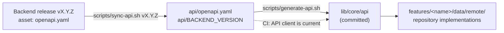

# Backend API

The data of Money Scribe lives on the server. The server is the Django project in the
`money-scribe-backend` repository, and the two repositories agree on the API through **one
written contract**: an OpenAPI file that the backend generates from its code and attaches to
every release as `openapi.yaml`. This page explains how the app pins a release of that contract,
generates its typed client from it, keeps the two in step, and finds the server.

The working agreement between the two sides (who decides what, how an endpoint is requested and
reviewed) is in the backend repository, in its `docs/api-collaboration.md`. An API request is an
issue in the **backend** repository; link it from a task here as `alihaidar0/money-scribe-backend#12`.

Until a contract is pinned the app keeps reading invented data from its fake repositories
([`architecture.md`](architecture.md), *Fake data now, the server later*), and nothing on this page
runs: every check below is skipped without `api/openapi.yaml`.



| Piece | What it is |
| --- | --- |
| `api/BACKEND_REPO` | One line, `OWNER/REPO` of the backend repository |
| `api/openapi.yaml` | The pinned contract: a verbatim copy of a release asset; never edited |
| `api/BACKEND_VERSION` | The release tag (or, before the first release, the commit) that was pinned |
| `swagger_parser.yaml` | Settings of the client generator |
| `lib/core/api/` | The generated client (Retrofit and Dio, `json_serializable` models); committed, never edited |
| `scripts/sync-api.sh`, `scripts/generate-api.sh` | Pin a release and regenerate the client |
| **API client is current** (`ci.yml`) | Fails a pull request whose client does not match the contract |
| `backend-contract.yml` | Optional weekly reminder that the backend has a newer release |

## 1. First time: connect the app to the backend

Done once, in its own pull request, when the backend has published its first release.

1. **Add the packages.** The generator writes [Retrofit](https://pub.dev/packages/retrofit) clients on
   top of [Dio](https://pub.dev/packages/dio), with `json_serializable` models. Every package of
   the app is pinned to an exact version, so give the versions to `flutter pub add` (these are the
   versions that resolve with the other packages today; Dependabot keeps them current):

   ```bash
   flutter pub add dio:5.11.1 retrofit:4.10.0 json_annotation:4.12.0
   flutter pub add --dev build_runner:2.16.1 json_serializable:6.14.1 retrofit_generator:10.2.12 swagger_parser:1.45.0
   ```

2. **Name the backend repository:**

   ```bash
   mkdir -p api
   echo 'alihaidar0/money-scribe-backend' > api/BACKEND_REPO
   ```

3. **Sign in to GitHub** with an account that can read the backend (needed for a private
   repository; the token stays in `gh`'s own store, the scripts never print or save it):

   ```bash
   gh auth login
   ```

4. **Pin a release and generate the client** (section 2).
5. **Commit** `api/`, `lib/core/api/`, `pubspec.yaml` and `pubspec.lock` together.

The analyzer, the spell checker and the diff view are already set up for the generated folder
(`analysis_options.yaml`, `cspell.json`, `.gitattributes`), and the pre-commit hook and the
**Format** job skip `api/openapi.yaml`, which must stay byte-identical to the release asset.

## 2. Pin a release and generate the client

```bash
scripts/sync-api.sh v1.0.0
```

It downloads the `openapi.yaml` asset of that backend release with the GitHub CLI, writes it to
`api/openapi.yaml`, records the release in `api/BACKEND_VERSION`, and regenerates the client
(`swagger_parser`, then `build_runner`, then `dart format`). Nothing is written when the download
fails, so the contract and its version note never disagree.

| Command | What it does |
| --- | --- |
| `scripts/sync-api.sh vX.Y.Z` | Pin a release and regenerate the client |
| `scripts/sync-api.sh --commit <sha>` | Before the backend's first release: pin `openapi/schema.yaml` at that commit (the full SHA is recorded) |
| `scripts/sync-api.sh vX.Y.Z --no-generate` | Pin only |
| `scripts/sync-api.sh vX.Y.Z --require-verified` | Fail unless the release attestation verifies (see below) |
| `scripts/generate-api.sh` | Regenerate the client from the pinned contract (after changing `swagger_parser.yaml` or upgrading a generator) |

- **Verification.** The backend requires *Immutable releases*, so each release carries a signed
  attestation. The script checks the downloaded file against it with `gh release verify-asset`
  (GitHub CLI 2.81 or newer, which the dev image provides). If a release has no attestation the
  script says so and carries on; `--require-verified` makes that an error.
- **Never edit** `api/openapi.yaml` or anything in `lib/core/api/` by hand. Change the contract
  (through the backend) or `swagger_parser.yaml`, then regenerate.
- **Review** the diff of `api/openapi.yaml`: it is the API change. GitHub folds the generated
  client in the pull request view.

## 3. The CI check: API client is current

When a pull request has both `pubspec.lock` and `api/openapi.yaml`, the **API client is current**
job of `ci.yml` runs `scripts/generate-api.sh` and fails if `lib/core/api/` differs from what is
committed (including files that were generated but never committed). It is part of the required
**CI passed** check and is skipped while no contract is pinned. If it fails, run
`scripts/generate-api.sh` and commit the result.

## 4. Move to a new backend release

1. Read the release notes of the backend and look for entries labelled `breaking change`.
2. Run `scripts/sync-api.sh vX.Y.Z` with the new tag.
3. Let the compiler (`fanalyze`) and the tests show what changed, and fix the code.
4. Open a pull request with `api/` and `lib/core/api/`. Merge when the app builds and its tests pass.

The `backend-contract.yml` workflow can remind you. Every Monday it compares `api/BACKEND_VERSION`
with the newest backend release and keeps **one** issue open (label `dependencies`) while a newer
release exists; the issue closes by itself once the app is current. It is off until you set the
repository variable `BACKEND_REPO` (`OWNER/REPO` of the backend); a private backend also needs the
secret `BACKEND_READ_TOKEN` ([`github-setup.md`](github-setup.md), section 3). A backend that
cannot be read fails the run instead of reporting "up to date".

## 5. Using the client in the app

The generated client is shared code, so it lives in `core/` and follows the layering in
[`architecture.md`](architecture.md): only the **data** layer of a feature uses it.

- A feature keeps its repository **interface** in `domain/`. The remote implementation goes in
  `data/remote/remote_<name>_repository.dart`: it calls the generated client, maps the generated
  models to the feature's entities, and turns errors into the failures the Bloc already knows.
- `main` builds the Dio instance and the `RestClient` once and passes them to the remote
  repositories. Switching a feature means choosing its remote repository in `main` and deleting its
  `data/fake/` folder; `bloc/` and `presentation/` do not change.
- Generated models never reach a Bloc or a screen. The architecture test enforces it.
- **Amounts.** A decimal field is declared in the contract as `type: string, format: decimal`, so
  the generated model holds a `String`. Read it with `Money.tryParse(text, currency)` (lossless),
  never with `double`; send it back with `Money.toDecimalString()`.
- **Dates** arrive as ISO 8601 UTC timestamps; convert to local time only for display.
- **Nothing sensitive in logs.** Do not add a Dio logging interceptor that prints requests or
  responses: they hold amounts and personal data.

### Tokens and errors

- **Authentication** is the app's own code, outside the generated folder: `AuthInterceptor` in
  `lib/core/network/` attaches the access token and refreshes it on `401 token_expired`
  ([`architecture.md`](architecture.md), *The network layer*). Tokens live in the platform's secure
  storage, never in `shared_preferences` or the repository.
- **Errors.** The backend returns one documented body for every error raised inside an API view:

  ```json
  {
    "type": "validation_error",
    "errors": [
      { "code": "required", "detail": "This field is required.", "attr": "name" }
    ]
  }
  ```

  `type` is `validation_error`, `client_error` or `server_error`. Each item has a stable `code`
  (branch on it, not on the text), a human `detail`, and `attr`: the field name (dotted when
  nested) or `null`. The contract documents `400`, `401`, `403`, `404` and `429` on every
  operation. Because the app is available in English and Arabic, show texts from the ARB files
  chosen by `code`, and use `detail` only as a fallback.

  An error raised outside the API views (a disallowed host, a URL that is not part of the API)
  keeps Django's normal HTML or plain-text body: treat a response that is not this JSON as a
  generic failure.

  ```dart
  /// A message for the user and, for a form, the field errors (attr -> detail).
  ({String message, Map<String, String> fields}) describeError(DioException e) {
    final response = e.response;
    if (response == null) {
      return (message: 'Cannot reach the server', fields: {});
    }
    final data = response.data;
    if (data is Map<String, dynamic> && data['errors'] is List) {
      final items = (data['errors'] as List).whereType<Map<String, dynamic>>();
      final fields = {
        for (final item in items)
          if (item['attr'] is String) item['attr'] as String: '${item['detail']}',
      };
      final general = [
        for (final item in items)
          if (item['attr'] == null) '${item['detail']}',
      ];
      return (
        message: general.isEmpty
            ? 'Please check the highlighted fields'
            : general.first,
        fields: fields,
      );
    }
    // HTML or plain text from Django, not the API's error body.
    return (message: 'Request failed (${response.statusCode})', fields: {});
  }
  ```

  The strings above are only placeholders: in the app they come from the ARB files.

## 6. Where the app finds the server

### The base URL

The URL differs per environment, so it is a build-time value and never written in the source.
`ApiConfig` (`lib/core/environment/api_config.dart`) reads `API_BASE_URL` and the name is listed in
`.env.example`. Both repositories are public, so the value is kept out of Git, in two places that
hold the same name:

- **On your machine:** one file per environment at the root, `.env.staging` and `.env.production`.
  Git ignores them (`.env.*`), and the tools that guard secrets refuse to read them. A new container
  needs them created again from `.env.example`. The launch configurations, the "Run app on
  emulator" task and `flutter run --flavor staging --dart-define-from-file=.env.staging` pass the
  file to the build.
- **In CI:** a variable named `API_BASE_URL` on each GitHub environment (`staging`, `production`).
  Only the signed Android build runs in an environment, so only it gets the address: it writes
  `.env.<environment>` from the variable, never prints it, and stops the build if the value is not a
  bare https address. Test builds, the web build and the iOS check have none.

The value is **the server only**: `https://host`, no path and no trailing slash. The generated
client already writes `/api/v1/...` in every path, so an address with `/api/v1` would call
`/api/v1/api/v1/...`. `ApiConfig` refuses plain HTTP (except `http://localhost`, `127.0.0.1` and
`10.0.2.2` in a debug build), a path, a query and a login, and stops the app at start with a
message that does not repeat the value, so a mistake is found at once.

An **empty value means "no server"**. The app then keeps its fake repositories: this is how the
production build behaves until the production backend exists, and how every test build behaves.

The address is public once the app is built: it is compiled in, and obfuscation does not hide
strings. Keeping it out of Git is about not advertising hosts in a public repository and about
changing one without a code change. It is not a secret store: never put a key, a password or a
token in these files.

### A backend running on your machine

The app runs on the **emulator** or in the **browser**, both on your host, never in the dev
container. The backend runs in its own dev container with port 8000 published to the host, so the
app reaches it through the host. `host.docker.internal` is only used for adb and is the wrong
address for the API.

| Where the app runs | Base URL | Also needed |
| --- | --- | --- |
| Android emulator on the host | `http://10.0.2.2:8000` (the emulator's alias for the host's loopback) | `10.0.2.2` in the backend's `ALLOWED_HOSTS` (its development defaults include it), and the cleartext exception below |
| Browser on the host (`frunw`, port 8080) | `http://localhost:8000` | The origin `http://localhost:8080` allowed by the backend's CORS settings (its development defaults allow it), because the two ports are different origins |
| Staging, production | `https://...` | Nothing: HTTPS needs no exception |

**Cleartext HTTP on Android.** Android blocks plain `http://` by default. Allow it for the local
addresses in **debug builds only**. In `android/app/src/debug/AndroidManifest.xml`, add inside
`<manifest>`:

```xml
<application android:networkSecurityConfig="@xml/network_security_config" />
```

and create `android/app/src/debug/res/xml/network_security_config.xml`:

```xml
<?xml version="1.0" encoding="utf-8"?>
<network-security-config>
  <domain-config cleartextTrafficPermitted="true">
    <domain includeSubdomains="false">10.0.2.2</domain>
    <domain includeSubdomains="false">localhost</domain>
  </domain-config>
</network-security-config>
```

Release builds, staging and production included, keep the default (HTTPS only). Flutter documents
the approach in its
[network policy](https://docs.flutter.dev/release/breaking-changes/network-policy-ios-android) note.

## 7. Authentication (contract pinned, app not connected yet)

The first API step is authentication: register, verify email, resend the code, sign in, refresh, sign
out and read the profile. It was agreed with the backend in `alihaidar0/money-scribe-backend#13`. The
contract is pinned (`api/BACKEND_VERSION` says at which backend commit) and **the contract wins** over
this summary. The app is not connected yet: the screens still use the fake repository.

All paths are under `/api/v1/auth/`.

| Call | Sends | Answers |
| --- | --- | --- |
| `register/` | `name`, `email`, `password`, `language`, `time_zone` | `201` with `email`, `code_expires_in`, `resend_available_in`; no session; the same answer for a new, a pending and a registered address |
| `verify-email/` | `email`, `code`, `device`, `language`, `time_zone` | `200` with the tokens and `user`; a correct code creates the session |
| `resend-code/` | `email` | `200` with `code_expires_in`, `resend_available_in`; the same for any address |
| `sign-in/` | `email`, `password`, `device`, `language`, `time_zone` | `200`, the same body as verify email |
| `refresh/` | `refresh_token`, `device` | `200` with the tokens (no `user`) |
| `sign-out/` | the access token, or `{"refresh_token"}` in the body | `204` |
| `profile/` (`GET`) | the access token | `id`, `name`, `email` and the read-only `language`, `time_zone` |

- **Tokens.** `access_token`, `refresh_token` (optional in the schema: the web form will use an
  HttpOnly cookie later), `token_type` (`Bearer`), `expires_in` (seconds) and `user` (`id` as a UUID,
  `name`, `email`). On mobile a missing `refresh_token` is a failure.
- **`device`** goes with verify email, sign in and every refresh: `device_id` (a random UUID created
  once and kept in secure storage), `device_name` (the model name, at most 100 characters, never the
  name the user gave the device), `platform` (`android`, `ios` or `web`), `os_version` (optional, left out
  on the web) and `app_version` (for example `1.0.0+1`).
- **`language`** is `en` or `ar`; **`time_zone`** is an IANA name and is left out when the device cannot
  read it.
- **The email code** has 6 digits and is kept as text, so a leading zero survives. The same length is
  used to verify an email, to reset a password and to change an email. The 4-digit PIN of the app lock
  is a different thing and does not change.
- **Passwords.** The server owns the policy and the app enforces **no** password rule: no minimum, no
  maximum, no checklist and no numbers in its hints. Sign-in never applies a policy, because an older
  account may have a password that no longer meets the current one. The app sends the text as typed,
  without trimming or normalising it (the server normalises it). The only check on the device is that
  the two fields match. The app has its own message per `password_*` code; the limit in the message
  comes from `min_length` on `password_too_short` and `max_length` on `password_too_long`, so a policy
  change needs no app release. For a `password_*` code the app does not know, it shows the English
  `detail` as it is.
- **Waits** are never constants in the app: they come from `Retry-After` (whole seconds),
  `resend_available_in` and `code_expires_in`. The schema declares `Retry-After` on every `429` and
  `503`, but the generated client does not return response headers, so the data layer reads it from
  the HTTP response of the failed call.

### Errors the screens handle

| Code | Status | What the app does |
| --- | --- | --- |
| field errors with `attr` | 400 | shows the message under the field; the `password_*` codes are described above |
| `code_invalid` | 400 | wrong code; `attempts_left` (optional) says how many tries remain |
| `code_expired` | 400 | offers "send a new code"; also the answer for an address that never had a code |
| `code_attempts_exceeded` | 429 | the code is dead; `Retry-After` is the wait until a new code may be requested |
| `resend_too_soon` | 429 | countdown from `Retry-After`; also the answer to a second register inside the 60 s cooldown |
| `resend_limit_reached` | 429 | countdown from `Retry-After` (up to an hour) for the limit of 5 resends per hour |
| `invalid_credentials` | 401 | one message for an unknown email and a wrong password |
| `email_not_verified` | 403 | only for a correct password; opens the verify screen and does not resend by itself |
| `sign_in_locked` | 429 | lock countdown from `Retry-After`, also for a correct password |
| `service_unavailable` | 503 | "try again shortly", with the wait from `Retry-After`; only register, resend, verify and sign in can answer it, and the body `type` is `server_error` (a separate schema from the other error bodies) |
| `token_expired` | 401 | the only code that triggers a refresh |
| `token_invalid`, `session_expired`, `session_signed_out`, `session_revoked_by_user`, `session_password_changed`, `session_email_changed`, `session_token_reuse` | 401 | final: drop the tokens and show sign-in with the reason |

### How the app behaves

- **Register** always opens the verify screen, with the hint "No code? You may already have an account:
  sign in or reset your password." A second register inside the 60 s cooldown answers `429`, which the
  register screen shows as a countdown on its button, not as an error. There is no "address is taken"
  message any more.
- **Refresh.** Only `401 token_expired` triggers it. One refresh runs at a time. The new pair is stored
  before it is used, and a lost response is retried once with the same token (the server accepts it for
  30 seconds). Any failure of refresh other than a `401` keeps the tokens.
- **Sign out** clears the tokens on the device even if the call fails. The app sends the refresh token
  in the body: then the only possible `401` is `token_invalid`, and a session that has already ended
  answers `204`, so no refresh is needed first. Sent with the access token alone, an already ended
  session answers `401 session_signed_out` (or another `session_*` code); the app treats that as
  success too, because the device is signed out either way.

### Limits (server settings, so the screens match)

Email code valid 10 minutes with 5 attempts per code; resend after 60 seconds, at most 5 per hour;
sign-in lock after 5 failures in 15 minutes, counted per account and per client address; access token
10 minutes; refresh token 30 days, renewed at each rotation; a session ends 90 days after sign-in at the
latest.

### For the privacy policy and the store forms

The server checks a new password against a public list of leaked passwords (Pwned Passwords) by sending
the first five characters of the password's hash, never the password, the full hash or any user data.
The privacy policy needs one sentence on it, for example: "To protect accounts, we check new passwords
against a public list of leaked passwords without sending the password or its full hash."

### Not covered yet

Reset password, change password, change email, delete account and edit name come as their own request
issues in the next step. The profile call is part of this step.

### What the app needs for this step

Secure storage for the tokens and the device id, device and app version information, and the time zone
name. Each is a package added with `flutter pub add` at an exact version (the owner runs it).

## Checklist for a change that touches the API

- [ ] `api/openapi.yaml` comes from a release (or an approved commit) and `api/BACKEND_VERSION` says which
- [ ] The client was regenerated with `scripts/generate-api.sh`, not edited by hand
- [ ] **API client is current** is green
- [ ] The base URL comes from `API_BASE_URL`, not from the source
- [ ] No token, password or real data in the repository, the tests or the fixtures
