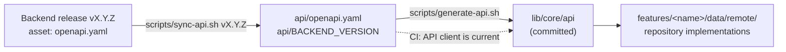

# Backend API

The data of Money Scribe lives on the server. The server is the Django project in the
`money-scribe-backend` repository, and the two repositories agree on the API through **one
written contract**: an OpenAPI file that the backend generates from its code and attaches to
every release as `openapi.yaml`. This page explains how the app pins a release of that contract,
generates its typed client from it, keeps the two in step, and finds the server.

The working agreement between the two sides (who decides what, how an endpoint is requested and
reviewed) is in the backend repository, in its `docs/api-collaboration.md`. An API request is an
issue in the **backend** repository; link it from a task here as `alihaidar0/money-scribe-backend#12`.

Until a contract is pinned the app keeps reading invented data from its fake repositories
([`architecture.md`](architecture.md), *Fake data now, the server later*), and nothing on this page
runs: every check below is skipped without `api/openapi.yaml`.



| Piece | What it is |
| --- | --- |
| `api/BACKEND_REPO` | One line, `OWNER/REPO` of the backend repository |
| `api/openapi.yaml` | The pinned contract: a verbatim copy of a release asset; never edited |
| `api/BACKEND_VERSION` | The release tag (or, before the first release, the commit) that was pinned |
| `swagger_parser.yaml` | Settings of the client generator |
| `lib/core/api/` | The generated client (Retrofit and Dio, `json_serializable` models); committed, never edited |
| `scripts/sync-api.sh`, `scripts/generate-api.sh` | Pin a release and regenerate the client |
| **API client is current** (`ci.yml`) | Fails a pull request whose client does not match the contract |
| `backend-contract.yml` | Optional weekly reminder that the backend has a newer release |

## 1. First time: connect the app to the backend

Done once, in its own pull request, when the backend has published its first release.

1. **Add the packages.** The generator writes [Retrofit](https://pub.dev/packages/retrofit) clients on
   top of [Dio](https://pub.dev/packages/dio), with `json_serializable` models. Every package of
   the app is pinned to an exact version, so give the versions to `flutter pub add` (these are the
   versions that resolve with the other packages today; Dependabot keeps them current):

   ```bash
   flutter pub add dio:5.11.1 retrofit:4.10.0 json_annotation:4.12.0
   flutter pub add --dev build_runner:2.16.1 json_serializable:6.14.1 retrofit_generator:10.2.12 swagger_parser:1.45.0
   ```

2. **Name the backend repository:**

   ```bash
   mkdir -p api
   echo 'alihaidar0/money-scribe-backend' > api/BACKEND_REPO
   ```

3. **Sign in to GitHub** with an account that can read the backend (needed for a private
   repository; the token stays in `gh`'s own store, the scripts never print or save it):

   ```bash
   gh auth login
   ```

4. **Pin a release and generate the client** (section 2).
5. **Commit** `api/`, `lib/core/api/`, `pubspec.yaml` and `pubspec.lock` together.

The analyzer, the spell checker and the diff view are already set up for the generated folder
(`analysis_options.yaml`, `cspell.json`, `.gitattributes`), and the pre-commit hook and the
**Format** job skip `api/openapi.yaml`, which must stay byte-identical to the release asset.

## 2. Pin a release and generate the client

```bash
scripts/sync-api.sh v1.0.0
```

It downloads the `openapi.yaml` asset of that backend release with the GitHub CLI, writes it to
`api/openapi.yaml`, records the release in `api/BACKEND_VERSION`, and regenerates the client
(`swagger_parser`, then `build_runner`, then `dart format`). Nothing is written when the download
fails, so the contract and its version note never disagree.

| Command | What it does |
| --- | --- |
| `scripts/sync-api.sh vX.Y.Z` | Pin a release and regenerate the client |
| `scripts/sync-api.sh --commit <sha>` | Before the backend's first release: pin `openapi/schema.yaml` at that commit (the full SHA is recorded) |
| `scripts/sync-api.sh vX.Y.Z --no-generate` | Pin only |
| `scripts/sync-api.sh vX.Y.Z --require-verified` | Fail unless the release attestation verifies (see below) |
| `scripts/generate-api.sh` | Regenerate the client from the pinned contract (after changing `swagger_parser.yaml` or upgrading a generator) |

- **Verification.** The backend requires *Immutable releases*, so each release carries a signed
  attestation. The script checks the downloaded file against it with `gh release verify-asset`
  (GitHub CLI 2.81 or newer, which the dev image provides). If a release has no attestation the
  script says so and carries on; `--require-verified` makes that an error.
- **Never edit** `api/openapi.yaml` or anything in `lib/core/api/` by hand. Change the contract
  (through the backend) or `swagger_parser.yaml`, then regenerate.
- **Review** the diff of `api/openapi.yaml`: it is the API change. GitHub folds the generated
  client in the pull request view.

## 3. The CI check: API client is current

When a pull request has both `pubspec.lock` and `api/openapi.yaml`, the **API client is current**
job of `ci.yml` runs `scripts/generate-api.sh` and fails if `lib/core/api/` differs from what is
committed (including files that were generated but never committed). It is part of the required
**CI passed** check and is skipped while no contract is pinned. If it fails, run
`scripts/generate-api.sh` and commit the result.

## 4. Move to a new backend release

1. Read the release notes of the backend and look for entries labelled `breaking change`.
2. Run `scripts/sync-api.sh vX.Y.Z` with the new tag.
3. Let the compiler (`fanalyze`) and the tests show what changed, and fix the code.
4. Open a pull request with `api/` and `lib/core/api/`. Merge when the app builds and its tests pass.

The `backend-contract.yml` workflow can remind you. Every Monday it compares `api/BACKEND_VERSION`
with the newest backend release and keeps **one** issue open (label `dependencies`) while a newer
release exists; the issue closes by itself once the app is current. It is off until you set the
repository variable `BACKEND_REPO` (`OWNER/REPO` of the backend); a private backend also needs the
secret `BACKEND_READ_TOKEN` ([`github-setup.md`](github-setup.md), section 3). A backend that
cannot be read fails the run instead of reporting "up to date".

## 5. Using the client in the app

The generated client is shared code, so it lives in `core/` and follows the layering in
[`architecture.md`](architecture.md): only the **data** layer of a feature uses it.

- A feature keeps its repository **interface** in `domain/`. The remote implementation goes in
  `data/remote/remote_<name>_repository.dart`: it calls the generated client, maps the generated
  models to the feature's entities, and turns errors into the failures the Bloc already knows.
- `main` builds the Dio instance and the `RestClient` once and passes them to the remote
  repositories. Switching a feature means choosing its remote repository in `main` and deleting its
  `data/fake/` folder; `bloc/` and `presentation/` do not change.
- Generated models never reach a Bloc or a screen. The architecture test enforces it.
- **Amounts.** A decimal field is declared in the contract as `type: string, format: decimal`, so
  the generated model holds a `String`. Read it with `Money.tryParse(text, currency)` (lossless),
  never with `double`; send it back with `Money.toDecimalString()`.
- **Dates** arrive as ISO 8601 UTC timestamps; convert to local time only for display.
- **Nothing sensitive in logs.** Do not add a Dio logging interceptor that prints requests or
  responses: they hold amounts and personal data.

### Tokens and errors

- **Authentication** is the app's own code, outside the generated folder: `AuthInterceptor` in
  `lib/core/network/` attaches the access token and refreshes it on `401 token_expired`
  ([`architecture.md`](architecture.md), *The network layer*). Tokens live in the platform's secure
  storage, never in `shared_preferences` or the repository.
- **Errors.** The backend returns one documented body for every error raised inside an API view:

  ```json
  {
    "type": "validation_error",
    "errors": [
      { "code": "required", "detail": "This field is required.", "attr": "name" }
    ]
  }
  ```

  `type` is `validation_error`, `client_error` or `server_error`. Each item has a stable `code`
  (branch on it, not on the text), a human `detail`, and `attr`: the field name (dotted when
  nested) or `null`. The contract documents `400`, `401`, `403`, `404` and `429` on every
  operation. Because the app is available in English and Arabic, show texts from the ARB files
  chosen by `code`, and use `detail` only as a fallback.

  An error raised outside the API views (a disallowed host, a URL that is not part of the API)
  keeps Django's normal HTML or plain-text body: treat a response that is not this JSON as a
  generic failure.

  ```dart
  /// A message for the user and, for a form, the field errors (attr -> detail).
  ({String message, Map<String, String> fields}) describeError(DioException e) {
    final response = e.response;
    if (response == null) {
      return (message: 'Cannot reach the server', fields: {});
    }
    final data = response.data;
    if (data is Map<String, dynamic> && data['errors'] is List) {
      final items = (data['errors'] as List).whereType<Map<String, dynamic>>();
      final fields = {
        for (final item in items)
          if (item['attr'] is String) item['attr'] as String: '${item['detail']}',
      };
      final general = [
        for (final item in items)
          if (item['attr'] == null) '${item['detail']}',
      ];
      return (
        message: general.isEmpty
            ? 'Please check the highlighted fields'
            : general.first,
        fields: fields,
      );
    }
    // HTML or plain text from Django, not the API's error body.
    return (message: 'Request failed (${response.statusCode})', fields: {});
  }
  ```

  The strings above are only placeholders: in the app they come from the ARB files.

## 6. Where the app finds the server

### The base URL

The URL differs per environment, so it is a build-time value and never written in the source.
`ApiConfig` (`lib/core/environment/api_config.dart`) reads `API_BASE_URL` and the name is listed in
`.env.example`. Both repositories are public, so the value is kept out of Git, in two places that
hold the same name:

- **On your machine:** one file per environment at the root, `.env.staging` and `.env.production`.
  Git ignores them (`.env.*`), and the tools that guard secrets refuse to read them. A new container
  needs them created again from `.env.example`. The launch configurations, the "Run app on
  emulator" task and `flutter run --flavor staging --dart-define-from-file=.env.staging` pass the
  file to the build.
- **In CI:** a variable named `API_BASE_URL` on each GitHub environment (`staging`, `production`).
  Only the signed Android build runs in an environment, so only it gets the address: it writes
  `.env.<environment>` from the variable, never prints it, and stops the build if the value is not a
  bare https address. Test builds, the web build and the iOS check have none.

The sign-in bot check has one more build-time value of the same kind, `TURNSTILE_SITE_KEY` (section 7):
the **public** site key of the Cloudflare Turnstile widget of that environment, read by
`TurnstileConfig` (`lib/core/environment/turnstile_config.dart`). It lives in the same two places, as
a **variable** (never a secret) of the GitHub environment and a line of `.env.<environment>`, and the
build stops if it holds anything but letters, digits, `-` and `_`. The secret key of Turnstile
belongs to the backend alone and never comes near this repository or the app. Without a key the
check cannot be shown and the sign-in says to try again later.

The value is **the server only**: `https://host`, no path and no trailing slash. The generated
client already writes `/api/v1/...` in every path, so an address with `/api/v1` would call
`/api/v1/api/v1/...`. `ApiConfig` refuses plain HTTP (except `http://localhost`, `127.0.0.1` and
`10.0.2.2` in a debug build), a path, a query and a login, and stops the app at start with a
message that does not repeat the value, so a mistake is found at once.

An **empty value means "no server"**. The app then keeps its fake repositories: this is how the
production build behaves until the production backend exists, and how every test build behaves.

The address is public once the app is built: it is compiled in, and obfuscation does not hide
strings. Keeping it out of Git is about not advertising hosts in a public repository and about
changing one without a code change. It is not a secret store: never put a key, a password or a
token in these files.

### The free staging server sleeps

The staging server runs on a free instance that **sleeps after 15 minutes without a request**; the first
request afterwards takes about a minute. The production server will not sleep. So in staging builds
(and only there):

- a request that has waited more than about 5 seconds makes the app show a note above the screen,
  "The server is starting", which says why and that the production server does not sleep. It never blocks
  the screen underneath and disappears when the server answers;
- the app sends one silent `GET /healthz` at start (no data, no token, the answer is ignored), so the
  server is often awake by the time the person signs in. A build with no server address sends nothing.

The timeouts are long for the same reason (90 seconds to connect and to receive).

### A backend running on your machine

The app runs on the **emulator** or in the **browser**, both on your host, never in the dev
container. The backend runs in its own dev container with port 8000 published to the host, so the
app reaches it through the host. `host.docker.internal` is only used for adb and is the wrong
address for the API.

| Where the app runs | Base URL | Also needed |
| --- | --- | --- |
| Android emulator on the host | `http://10.0.2.2:8000` (the emulator's alias for the host's loopback) | `10.0.2.2` in the backend's `ALLOWED_HOSTS` (its development defaults include it), and the cleartext exception below |
| Browser on the host (`frunw`, port 8080) | `http://localhost:8000` | The origin `http://localhost:8080` allowed by the backend's CORS settings (its development defaults allow it), because the two ports are different origins |
| Staging, production | `https://...` | Nothing: HTTPS needs no exception |

**Cleartext HTTP on Android.** Android blocks plain `http://` by default. Allow it for the local
addresses in **debug builds only**. In `android/app/src/debug/AndroidManifest.xml`, add inside
`<manifest>`:

```xml
<application android:networkSecurityConfig="@xml/network_security_config" />
```

and create `android/app/src/debug/res/xml/network_security_config.xml`:

```xml
<?xml version="1.0" encoding="utf-8"?>
<network-security-config>
  <domain-config cleartextTrafficPermitted="true">
    <domain includeSubdomains="false">10.0.2.2</domain>
    <domain includeSubdomains="false">localhost</domain>
  </domain-config>
</network-security-config>
```

Release builds, staging and production included, keep the default (HTTPS only). Flutter documents
the approach in its
[network policy](https://docs.flutter.dev/release/breaking-changes/network-policy-ios-android) note.

## 7. Authentication (connected)

The first API step is authentication: register, verify email, resend the code, sign in, refresh, sign
out and read the profile. It was agreed with the backend in `alihaidar0/money-scribe-backend#13`. The
contract is pinned (`api/BACKEND_VERSION` says at which backend commit) and **the contract wins** over
this summary. A build with a server address (`API_BASE_URL`, section 6) uses the real account,
`RemoteAuthRepository`; a build without one keeps the fake repository. The rest of the app is still
fake.

All paths are under `/api/v1/auth/`.

| Call | Sends | Answers |
| --- | --- | --- |
| `register/` | `name`, `email`, `password`, `language`, `time_zone` | `201` with `email`, `code_expires_in`, `resend_available_in`; no session; the same answer for a new, a pending and a registered address |
| `verify-email/` | `email`, `code`, `device`, `language`, `time_zone` | `200` with the tokens and `user`; a correct code creates the session |
| `resend-code/` | `email` | `200` with `code_expires_in`, `resend_available_in`; the same for any address |
| `sign-in/` | `email`, `password`, `device`, `language`, `time_zone` | `200`, the same body as verify email |
| `refresh/` | `refresh_token`, `device` | `200` with the tokens (no `user`) |
| `sign-out/` | the access token, or `{"refresh_token"}` in the body | `204` |
| `profile/` (`GET`) | the access token | `id`, `name`, `email` and the read-only `language`, `time_zone` |

- **Tokens.** `access_token`, `refresh_token` (optional in the schema: the web form will use an
  HttpOnly cookie later), `token_type` (`Bearer`), `expires_in` (seconds) and `user` (`id` as a UUID,
  `name`, `email`). On mobile a missing `refresh_token` is a failure.
- **`device`** goes with verify email, sign in and every refresh: `device_id` (a random UUID created
  once and kept in secure storage), `device_name` (the model name, at most 100 characters, never the
  name the user gave the device), `platform` (`android`, `ios` or `web`), `os_version` (optional, left out
  on the web) and `app_version` (for example `1.0.0+1`).
- **`language`** is `en` or `ar`; **`time_zone`** is an IANA name and is left out when the device cannot
  read it.
- **The email code** has 6 digits and is kept as text, so a leading zero survives. The same length is
  used to verify an email, to reset a password and to change an email. The 4-digit PIN of the app lock
  is a different thing and does not change.
- **Passwords.** The server owns the policy and the app enforces **no** password rule: no minimum, no
  maximum, no checklist and no numbers in its hints. Sign-in never applies a policy, because an older
  account may have a password that no longer meets the current one. The app sends the text as typed,
  without trimming or normalising it (the server normalises it). The only check on the device is that
  the two fields match. The app has its own message per `password_*` code; the limit in the message
  comes from `min_length` on `password_too_short` and `max_length` on `password_too_long`, so a policy
  change needs no app release. For a `password_*` code the app does not know, it shows the English
  `detail` as it is.
- **Waits** are never constants in the app: they come from `Retry-After` (whole seconds),
  `resend_available_in` and `code_expires_in`. The schema declares `Retry-After` on every `429` and
  `503`, but the generated client does not return response headers, so the data layer reads it from
  the HTTP response of the failed call.

### Errors the screens handle

| Code | Status | What the app does |
| --- | --- | --- |
| field errors with `attr` | 400 | shows the message under the field; the `password_*` codes are described above |
| `code_invalid` | 400 | wrong code; `attempts_left` (optional) says how many tries remain |
| `code_expired` | 400 | offers "send a new code"; also the answer for an address that never had a code |
| `code_attempts_exceeded` | 429 | the code is dead; `Retry-After` is the wait until a new code may be requested |
| `resend_too_soon` | 429 | countdown from `Retry-After`; also the answer to a second register inside the 60 s cooldown |
| `resend_limit_reached` | 429 | countdown from `Retry-After` (up to an hour) for the limit of 5 resends per hour |
| `email_not_registered` | 401 | sign-in only, `attr` `email`: said under the email field. The server checks the email first, so a wrong-password answer never comes for an unknown address |
| `wrong_password` | 401 | sign-in only, `attr` `password`: said under the password field |
| `invalid_credentials` | 401 | sign-in: any other refusal (a deactivated account), said in a banner |
| `invalid_password` | 400 | change password and change email, `attr` `current_password`: said under the current-password field (a `400`, so the session handling is not triggered) |
| `email_unchanged` | 400 | change email, `attr` `email`: the account already has this address, said under the new-email field |
| `email_already_registered` | 409 | change email: another account uses the address, said under the new-email field, or on the code screen when it was taken meanwhile |
| `password_unchanged` | 400 | change password, `attr` `password`: the new password equals the current one, said under the new-password field |
| `password_attempts_exceeded` | 429 | change password (and delete account): 5 wrong current passwords lock both for 15 minutes; the button counts down `Retry-After`; sign-in is not affected |
| `email_not_verified` | 403 | only for a correct password; opens the verify screen and does not resend by itself |
| `sign_in_locked` | 429 | lock countdown from `Retry-After`, also for a correct password |
| `service_unavailable` | 503 | "try again shortly", with the wait from `Retry-After`; only register, resend, verify and sign in can answer it, and the body `type` is `server_error` (a separate schema from the other error bodies) |
| `captcha_required` | 400 | sign-in only, `attr` `captcha_token`, after 5 failed sign-ins from one address: shows the bot check and sends the same sign-in again with its token |
| `captcha_invalid` | 400 | sign-in only: the token was wrong, expired (5 minutes) or used; shows a new bot check |
| `token_expired` | 401 | the only code that triggers a refresh |
| `token_invalid`, `session_expired`, `session_signed_out`, `session_revoked_by_user`, `session_password_changed`, `session_email_changed`, `session_token_reuse` | 401 | final: drop the tokens and show sign-in with the reason |

### How the app behaves

- **Sign-in bot check.** After 5 failed sign-ins from one address the server answers
  `400 captcha_required` until the sign-in is sent again with `captcha_token`, the token of a
  Cloudflare Turnstile widget created with the action `sign_in`. The app shows the widget in a bottom
  sheet (`features/auth/presentation/sign_in_challenge_sheet.dart`). It is the official
  `webview_flutter` showing a small page of our own (`core/challenge/turnstile_page.dart`), loaded
  with the address of the server as its base, which is the host the site key allows; the web view
  cannot leave that page and only the widget's script and frames of Cloudflare run in it. The token is
  single use and lives five minutes, so it is sent once, as soon as the widget returns it, and a
  refused token (`captcha_invalid`) opens a new widget. It appears when failures are spread over several
  accounts or unknown emails: five wrong passwords on one account lock that account first (see Limits). The person solving the widget is the only
  trigger: the app never sends a sign-in again by itself. Android and iOS only; on the web build the
  sheet says the check is not available. Builds with the fake account show a demo button instead.

- **Register** always opens the verify screen, with the hint "No code? You may already have an account:
  sign in or reset your password." A second register inside the 60 s cooldown answers `429`, which the
  register screen shows as a countdown on its button, not as an error. There is no "address is taken"
  message any more.
- **Refresh.** Only `401 token_expired` triggers it. One refresh runs at a time. The new pair is stored
  before it is used, and a lost response is retried once with the same token (the server accepts it for
  30 seconds). Any failure of refresh other than a `401` keeps the tokens.
- **Session restore.** The tokens are read from the secure storage before the first screen, with no
  network, so the app opens on the right screen. The server is then asked about the session once, in the
  background (the profile): a session it ended signs the person out, a lost connection keeps them
  signed in.
- **Sign out** clears the tokens on the device even if the call fails. The app sends the refresh token
  in the body: then the only possible `401` is `token_invalid`, and a session that has already ended
  answers `204`, so no refresh is needed first. Sent with the access token alone, an already ended
  session answers `401 session_signed_out` (or another `session_*` code); the app treats that as
  success too, because the device is signed out either way.

### Limits (server settings, so the screens match)

Email code valid 10 minutes with 5 attempts per code; resend after 60 seconds, at most 5 per hour;
access token 10 minutes; refresh token 30 days, renewed at each rotation; a session ends 90 days after sign-in at the
latest.

Sign-in limits (confirmed by the backend): every failed sign-in from one address (an unknown email, a
wrong password, or a challenge that did not verify) counts in a 15-minute window. From 5 failures the
sign-in answers `captcha_required` until a solved token is sent; from 15 the address is locked
(`sign_in_locked`) for every account. Separately, 5 wrong passwords on one account from one address lock
that account for that address. With a single account that lock comes at the same moment as the 5th
failure of the address and is checked first, so the app sees `sign_in_locked` and never
`captcha_required`: the bot check appears when the failures are spread over several accounts or unknown
emails.

### For the privacy policy and the store forms

Two things in the sign-in flow involve a third party, and the privacy policy needs one sentence on each.
Deleting the account has its own wording, at the end of this section.
There is no policy yet (it comes with Google Play); this is the wording to use then, and the points to
check against the Play Data safety and Apple App Privacy forms when they are filled in.

- **Leaked-password check (done by the server).** When a password is registered, the server sends only
  the first five characters of its SHA-1 hash to the Pwned Passwords range service. The password and the
  full hash never leave the server, and the service never receives the email or the device. The app
  itself sends nothing to that service. The check is skipped when the service cannot be reached, so the
  wording must not promise that every password is checked. It runs at registration, when a password is
  reset and when it is changed.
  Sentence: "When you choose a password, we may check it against a public list of leaked passwords. Only
  the first five characters of its hash are sent, never the password or the full hash." The data sent
  identifies no one, so this is a sentence for the policy rather than an entry for the forms.
- **Bot check at sign-in (done by the app).** After repeated failed sign-ins the app shows a Cloudflare
  Turnstile widget, which runs in a web view on the device. Cloudflare receives technical information
  such as the IP address and browser characteristics to tell people from automated programs.
  Sentence: "After repeated failed sign-ins we ask you to complete a security check provided by
  Cloudflare, which processes technical information about your device to tell people from automated
  programs." This is data going from the app to a third party, so check it against the "shared data"
  wording of the store forms, and against Cloudflare's own terms, before publishing.
- **Deleting the account (done by the app and the server).** Account deletion is inside the app
  (Settings, Account, Delete account) and needs the password. The server deletes the account and all
  the data it owns in one step and for good: there is no soft delete and no copy kept. Every session
  ends with it, and a confirmation email goes to the address, which is used only for that email and then
  forgotten. Sentence: "You can delete your account in the app at any time. Your account and all the data
  in it are permanently deleted from our server at once, and we keep no copy. We send one confirmation
  email to your address and then forget it." Limits of the wording: it covers the server only. The app
  deletes the push token of the device when the account is deleted (and on every sign-out), but the
  Firebase installation ID is not removed by that and Firebase drops it when the installation is inactive,
  so say what Firebase keeps in the policy, and check the Play Data safety "data deletion" answers. Google
  Play also asks for a web address where a person can request deletion without the app; that is a
  publishing-time step for the owner.

### The push token and the account

Today the push token is not sent to the server: it is only copied by hand from staging builds to send a
test message from the Firebase console. The app deletes the token of the device whenever the person is
signed out (signing out, deleting the account, a session the server ended, a password reset), so a
signed-out device keeps no token that an earlier sign-in registered. Deleting a token makes Firebase give
the device a new, unrelated one the next time it is asked for.

The backend agreed the rules below (its own copy is in its `docs/api-fields.md`, "Push notifications").
The endpoints are built with the notifications feature, after the salary and preferences steps, and are
published in `openapi.yaml`; nothing is sent today.

Server rules:

- A token belongs to one account and to the session that registered it, with one token per `device_id`:
  a new token from the same device replaces the old one. It is never shared between accounts (a token
  registered by another account is moved).
- Two authenticated operations, both idempotent: register or replace the token, and remove it (it
  succeeds when there is nothing to remove). Both use the standard error body and the rate limits. The
  request carries no platform and no language: the platform comes from the session's device record, and a
  registration from a `web` session is refused with a documented error, since web push is not planned.
- Push is Android only for now: iOS comes later through the same endpoints, when the iOS work starts.
- The server deletes the token of a session whenever that session ends, for any reason (sign-out,
  revoked, password changed or reset, email changed, refresh-token reuse, expiry), and every token of an
  account in the same step as the rest of its data when the account is deleted.
- A token that Firebase reports as unregistered or invalid is deleted at once.
- Tokens are never logged, never returned by any endpoint and sent only to Firebase.
- A notification contains no amounts, names or other financial data. It is worded in the `language`
  stored on the account, the setting the emails use; the app sends no language per device.
- The server adds one data key, `screen`, so the app can open the right screen. Its value is one of a fixed
  list of screen identifiers; the first list has only `salary` (pay-day reminders), and every new value is
  added to the schema and the docs before the server sends it. There is no record id for now: pointing at
  one record would be its own agreed change, with an opaque id. The app treats the data of a push as
  untrusted input: it maps a value from a fixed list of screens, ignores any value it does not know, never
  opens an address or a route taken from the message, and the data carries no amounts, names or record
  contents.
- Retention, for the privacy policy: a push token is kept until its session ends or expires, and at most
  90 days.

What the app does when the endpoints exist:

- Registers the token after sign-in, whenever Firebase gives a new one, and only while notifications are
  allowed. A registration that fails (offline, error) is tried again at the next start, return to the app
  or new token; it is idempotent, so a repeat is safe.
- Removes the token when the person turns notifications off while staying signed in. The switch is in the
  system settings (the app's row only asks, and points to them), so the app notices it when it next
  reads the permission, at start and on return to the app, not at the moment it happens.
- Sign-out: call remove while the session is still valid, with a short timeout and ignoring any failure
  (offline, timeout, error), then delete the local Firebase token, then end the session.
- A session the server ended is any `401` other than `token_expired` (that includes `token_invalid`
  and `not_authenticated`, not only `session_*`); `token_expired` is the only `401` that is refreshed. This
  is part of the contract. The app then deletes the local token and does not call remove, which would be
  refused.
- Account deletion: delete the local token after the server confirms (already done).
- Language: the account's `language` and `time_zone` change with the settings `PATCH` of the preferences
  step, not with the profile update (`name` only) or the refresh request. The app calls it when the
  person changes the app language, so notifications follow without a new sign-in. When it sends a changed
  `time_zone` (the device zone differs from the last one sent) is decided with that step.

The server cleanup is the guarantee and the app cleanup an extra: the app cannot always tell that a
session ended, and the remove call needs a valid session.

### Resetting a password

Three calls, none of which signs anyone in: ask for a code (`password-reset/request/`, the same answer for
every address, so the app always goes on to the code screen), check the code (`password-reset/verify/`,
which answers a single-use `reset_token`), and set the new password (`password-reset/confirm/`, `204`).

- The app keeps the reset token in memory only and uses it once. A new code ends the reset that was going
  on. `reset_token_invalid` (or an app that lost the token) goes back to the first screen with a message.
- A refused password (`password_*`) leaves the token valid: the person types another one on the same
  screen, worded by the app from the code, the numbers coming from `min_length` / `max_length`.
- A new password equal to the current one is allowed here: the reset proves the mailbox, not the old
  password.
- Every wait is the server's: `Retry-After` on a `429`, and `resend_available_in` after a code. The
  buttons count it down. A `503` shows the "try again shortly" state.
- A saved reset ends every session of the account, this device's included: the app clears its tokens and
  goes to the "password changed" screen, then to sign-in.

### Changing the password

One call, signed in (`password/change/`): the current and the new password, both sent as typed.

- The answer is a new token pair. The server ended every other session and retired the refresh token this
  device used, so the app replaces its stored pair and the person stays signed in. An answer without a
  refresh token is a server failure.
- A wrong current password is `400 invalid_password` and is said under the current-password field. It is
  a `400`, not a `401`, so the app does not try to refresh or sign out.
- The new password is worded like at registration (`password_*`, the numbers from `min_length` /
  `max_length`), plus `password_unchanged` ("must be different from your current one"). The app checks only
  that the two new fields match.
- 5 wrong current passwords answer `429 password_attempts_exceeded` with the wait in `Retry-After`: the
  button counts it down (15 minutes), and nothing is sent until it ends. The same lock covers deleting the
  account. Signing in is not affected.
- The owner of the account gets an email about the change from the server.

### Deleting the account

One call, signed in (`account/delete/`, a `POST` with the password in the body, answer `204`): the password
is sent as typed.

- The account and every session end at once. The app clears its tokens, forgets any pending code or
  reset, and goes to the signed-out screens.
- A wrong password is `400 invalid_password` and is said under the password field of the dialog, which
  stays open.
- The lock after 5 wrong passwords is the same one as for changing the password (`429
  password_attempts_exceeded`, 15 minutes): the button counts down `Retry-After` and nothing is sent until
  it ends. A busy server (`503`) and a lost connection are said in the dialog.

### Editing the name

One call, signed in (`profile/`, a `PATCH` with only `name`): the answer is the updated profile.

- The Account screen has an "Edit name" row that opens a dialog with the current name. Save is off while
  the field is empty (spaces only) or the same as the current name; the field stops at 100 characters, the
  limit of the contract. The server trims the name and decides the rest.
- A refused name (`400` on `name`: `blank` or `required`, `max_length`, or any other code) is said under
  the field in the app's own words. A busy server (`503`) and a lost connection are said in the dialog,
  which keeps what was typed.
- The Account screen shows the new name at once, and the Settings row reads the profile again when the
  person comes back to it. Any other field in the body (`email`, `language`, `time_zone`) is refused with
  `read_only`, so the app sends only `name`; the language and time zone have their own settings call.

### Changing the email

Three calls, signed in (`email-change/`): ask for a code, confirm it, or cancel.

- **Ask** (`POST email-change/`): the new address and the current password, both sent as typed (the address
  trimmed). The server mails a 6-digit code to the **new** address and keeps the old one in force until the code
  is confirmed. A new request replaces the one that was pending. The answer has the wait before a new code
  (`resend_available_in`) and how long the code lives (`code_expires_in`); the app counts the first one down.
- **Confirm** (`POST email-change/confirm/`): the code as text. The account gets its new address, every other
  session ends, and this one goes on with the same tokens. The Account screen reads the profile again and
  says "Email changed".
- **Cancel** (`DELETE email-change/`): drops the pending change, so its code stops working; it answers `204`
  also when nothing is pending. If the call fails the app says so and stays on the code screen, because the
  code would still work.
- **Screens.** Account, "Change email" opens the form (ST-12): the new address and the current password, the
  button "Send code". The code screen (ST-12b) reuses the code page of the sign-up and reset flows: six
  boxes, the countdown to a new code, "Use another address" (back to the form, which asks for the password
  again) and "Cancel email change".
- **A new code asks for the password again** (Option A, the owner's decision): the server needs it for every
  request, so the app asks in a small dialog instead of keeping the password in memory. A wrong one is said
  on the code screen and the code that was sent still works.
- **Errors.** `invalid_password` (`400`) under the password field; `email_unchanged` (`400`) and any other
  refusal of the address under the new-email field; `email_already_registered` (`409`) under the field, or on
  the code screen when the address was taken while the code was on its way (the code is kept, but useless, so
  the person chooses another address). The waits are the server's: `password_attempts_exceeded` (the lock shared
  with changing the password and deleting the account), `resend_too_soon`, `resend_limit_reached` and
  `throttled` count down on the button; `code_attempts_exceeded` kills the code until a new one may be asked
  for. `503` shows "try again shortly".
- Nothing about the new address is checked by the app: the server says whether it is valid.

### What the app uses for this step

Secure storage for the tokens and the device id (`flutter_secure_storage`), the device model and system
version (`device_info_plus`), the app version (`package_info_plus`) and the time zone name
(`flutter_timezone`), all at exact versions. The code is in `core/storage/`, `core/device/` and
`core/network/` ([`architecture.md`](architecture.md), *The network layer*), and in
`features/auth/data/remote/`.

### When a new call fails against staging

The app logs only the name of the exception (never the answer, by design), so a failed call shows as
`ServerException` and the screen says "Something went wrong". The usual cause right after pinning a new
contract is a staging server that still runs an older backend build, which answers `404` for the new
endpoint.

1. Check the endpoint without signing in: an existing one answers `401`, a missing one `404`. Load the
   address from your own ignored `.env.staging`; never paste it, or any token, into an issue or a pull
   request.

   ```bash
   set -a; . ./.env.staging; set +a
   curl -s -o /dev/null -w "%{http_code}\n" -X POST "$API_BASE_URL/<path>" \
     -H 'Content-Type: application/json' -d '{}'
   ```

2. If it is `404`, ask the backend to deploy the pinned commit (`api/BACKEND_VERSION`) to staging, then try
   again.
3. To read what the app logged on a connected emulator: `adb -s <device> logcat -d -s flutter`.

### Notes on the generated client

- **Missing optional fields.** The generated models write a field they do not have as `null`
  (`"time_zone": null`), but the server wants it left out. `OmitNullsInterceptor` drops every `null` from a
  request body, so no generated file is edited.
- **`Retry-After`** is not returned by the generated methods: the data layer reads it from the failed
  call (`ApiFailure`). A `429` without it (the contract says it always has one) gets a wait of 30
  seconds, so the screen never counts down from zero.
- **The platform** is only `android` or `ios`; the contract lists `web`, which the app never sends.

## Checklist for a change that touches the API

- [ ] `api/openapi.yaml` comes from a release (or an approved commit) and `api/BACKEND_VERSION` says which
- [ ] The client was regenerated with `scripts/generate-api.sh`, not edited by hand
- [ ] **API client is current** is green
- [ ] The base URL comes from `API_BASE_URL`, not from the source
- [ ] No token, password or real data in the repository, the tests or the fixtures
